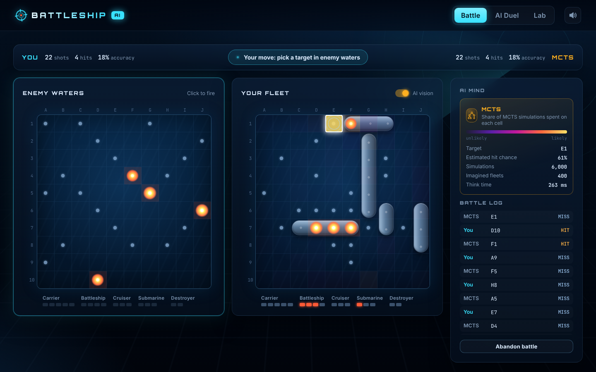
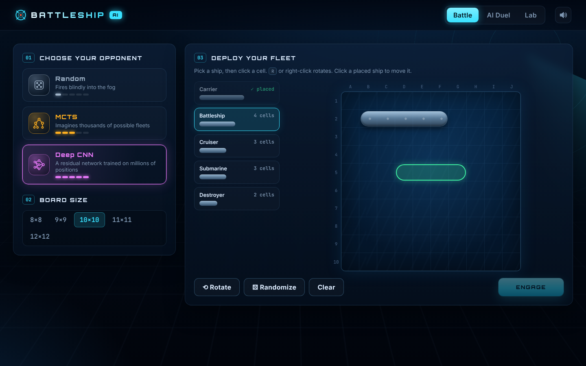
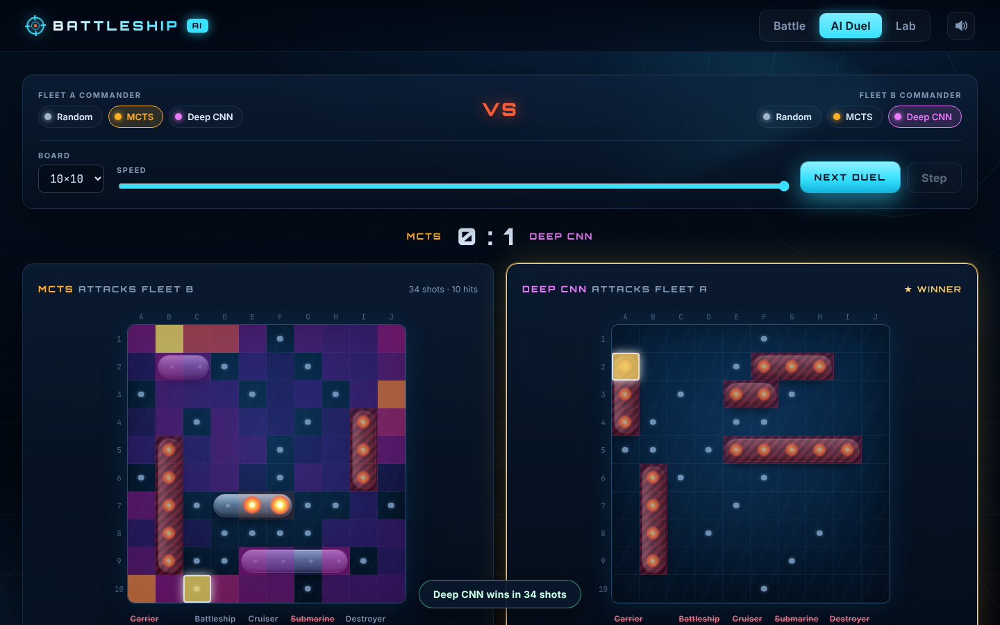
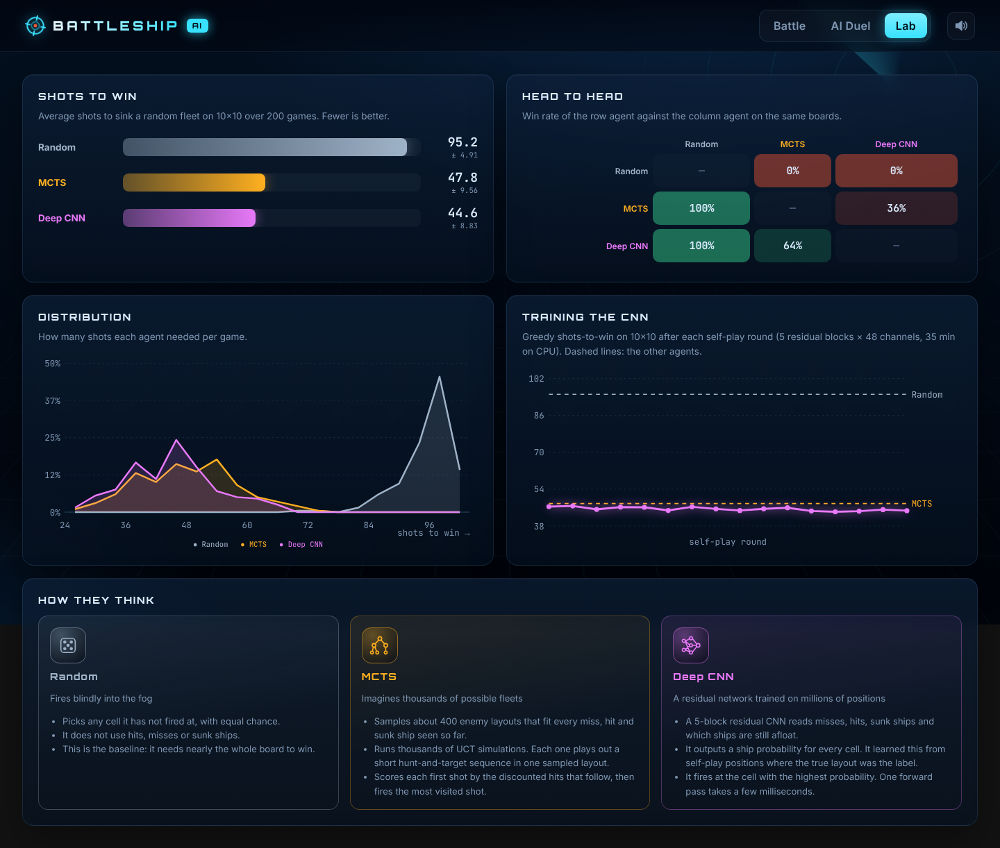

# Battleship AI

Play Battleship in the browser against three different AI opponents and watch how each one thinks:

| Opponent | How it plays | Shots to win (10×10, lower is better) |
|---|---|---|
| **Random** | Fires at a random unexplored cell | 95.2 |
| **MCTS** | Information Set Monte Carlo Tree Search over sampled hidden fleets | 47.8 |
| **Deep CNN** | Residual CNN trained on self-play to predict where ships are | **44.6** |

The results come from 200 identical random boards per agent (`python -m battleship_ai evaluate`). Head to head, the CNN beats MCTS in 64% of games, and both beat Random in every game.

The UI shows the **AI's mind** live. After each enemy shot, a heatmap on your own board shows where the AI thinks your ships are (CNN), or where it spent its simulations (MCTS).



| Fleet setup | AI duel | Lab |
|---|---|---|
|  |  |  |

## Quick start

```bash
pip install -r requirements.txt          # only numpy is needed to play
python -m battleship_ai                  # → http://localhost:8000
```

The trained network ships with the repository (`battleship_ai/weights/battleship_cnn.npz`). At play time it runs in pure numpy, so you do not need PyTorch to play.

### Modes

- **Battle**: choose an opponent and a board size (8×8 to 12×12). Place your fleet by hand (`R` or right-click rotates) or click Randomize, then fire.
- **AI Duel**: pick any two agents and watch them play each other at an adjustable speed. Each board shows that agent's heatmap.
- **Lab**: benchmark results, head-to-head win rates, distribution of shots to win, the CNN training curve, and how each agent works.

### Command line

```bash
python -m battleship_ai serve --port 8000 --open    # web UI (default command)
python -m battleship_ai play                        # play in the terminal
python -m battleship_ai play --watch mcts neural    # watch two AIs in the terminal
python -m battleship_ai evaluate --games 200 --save # benchmark (writes weights/benchmark.json)
python -m battleship_ai train                       # retrain the CNN (needs PyTorch)
pytest                                              # tests
```

## Rules

Classic Battleship: Carrier (5), Battleship (4), Cruiser (3), Submarine (3) and Destroyer (2). Ships are straight and do not overlap. Players take turns firing one shot. The defender says *miss*, *hit* or *sunk*. When a ship sinks, its name and position are revealed. The first player to sink the whole enemy fleet wins.

## How the agents work

### Random
It picks uniformly among the cells it has not fired at. To sink all 17 ship cells, it has to search most of the board.

### MCTS: Information Set Monte Carlo Tree Search (`agents/mcts_agent.py`)
Battleship hides information, so a normal game tree is not available. The agent uses **determinization** (Whitehouse, 2014):

1. `LayoutSampler` draws about 400 enemy layouts that agree with everything seen so far. Ships never lie on misses or sunk ships, every open hit is covered, and no surviving ship lies only on hit cells. The layouts are Python-int bitmasks, which keeps the sampler fast.
2. Each iteration takes one layout and runs a UCT pass: UCB1 selection, expansion of one untried shot, then a short *hunt and target* rollout (shoot random cells, then the neighbours of hits). Edges have one child per outcome (hit or miss), because the outcome depends on the sampled layout.
3. The reward is the discounted number of hits (γ = 0.85, horizon 10). The agent fires the most visited root shot. One move takes about 6,000 iterations, or 1 second at most.

### Deep CNN (`nn_model.py`, `train.py`, `agents/neural_agent.py`)
- **Input** (10 planes): one-hot unknown / miss / hit / sunk, a plane of ones (with zero padding, this marks the board edge), and one plane per fleet ship that tells if it is still afloat.
- **Network**: a fully convolutional ResNet, with a 3×3 stem and 5 residual blocks of 48 channels (about 212k parameters). Because it has no dense layers, one network plays every board size from 8×8 to 12×12.
- **Output**: a ship probability for every cell. The agent fires at the most likely unexplored cell.
- **Training**: supervised occupancy prediction on self-play positions, with masked binary cross-entropy against the true hidden layout. Round 0 learns from random play. Each later round lets the current network play (with 10 % random exploration), and it learns from the positions its own policy reaches (DAgger-style). Hundreds of games run in parallel as numpy arrays. Random flips and transposes add data. Training took 35 minutes on a 4-core CPU.
- **Inference**: weights are exported to `.npz` (float16). They run through a numpy forward pass (`im2col` + matmul) in a few milliseconds per move. Training checks that the numpy output matches PyTorch.

## Project layout

```
battleship_ai/
  game.py          rules: ships, boards, shots, observations
  sampling.py      bitmask placements and consistent-layout sampler
  agents/          random, MCTS and CNN agents (+ shared "insight" heatmaps)
  nn_model.py      feature encoding and numpy CNN inference
  train.py         PyTorch self-play training and export
  evaluate.py      benchmarks and head-to-head
  server.py        stdlib HTTP server and JSON API
  cli.py           terminal game (the original ASCII interface)
  web/             single-page UI (vanilla JS/CSS, no build step)
  weights/         trained CNN + benchmark results
tests/             pytest suite (rules, sampler, agents, API)
```

## What was fixed from the original version

The original prototype could not run as intended:
- `nn.py` was empty, so there was no neural agent.
- `Node.uct()` used `self.U_values` without calling it.
- Simulated shots always counted as hits (`np.random.randint(1, 2)`).
- The tree followed a child node that did not match the shot that was really fired.
- Ship placement had an off-by-one error (`y + size < max_size`), so ships never touched the right or bottom edge.

The project is now a package with a correct engine, the three agents above, a trained network, a web UI, a terminal UI, benchmarks and tests.

## References
- Whitehouse, D. (2014). *Monte Carlo tree search for games with hidden information and uncertainty* (Doctoral dissertation, University of York).
- Świechowski, M., Godlewski, K., Sawicki, B., & Mańdziuk, J. (2022). Monte Carlo tree search: A review of recent modifications and applications. *Artificial Intelligence Review*, 1-66.
- Text to ASCII Art Generator (TAAG). https://patorjk.com/software/taag/
